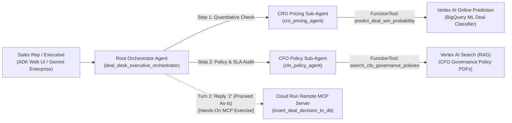

# Autonomous B2B Deal Desk — Google ADK Multi-Agent & MCP Workshop

Welcome to the hands-on **Google Agent Development Kit (ADK) & Model Context Protocol (MCP)** workshop repository.

When you open this repository in **Google Cloud Shell** (or on GitHub), this `README.md` is your complete guide to understanding **what the Deal Desk agent is**, **how its multi-agent architecture works**, **how to test it in Cloud Shell Web Preview**, and **how to connect a remote Cloud Run MCP server**.

---

## 1. What Is This Agent?

In enterprise B2B sales, approving a non-standard software contract—such as an enterprise deal with a steep discount, a competitor takeout incentive, or a custom SLA—typically takes days of manual review across **Sales (CRO)**, **Finance (CFO)**, and **Deal Desk Operations**.

The **Autonomous B2B Deal Desk & Margin Optimizer** is a multi-agent system built with the **Google Agent Development Kit (ADK)** and powered by **Gemini (`gemini-3.1-pro-preview`)**. It evaluates proposed B2B deals in seconds by combining:
1. **Quantitative Machine Learning** (win-probability and margin optimization scored on a live **Vertex AI Online Prediction Endpoint** trained with BigQuery ML).
2. **Qualitative Policy Grounding (RAG)** (auditing deal terms against official CFO governance PDFs indexed in **Vertex AI Search / Discovery Engine**).
3. **Transactional Actioning via MCP** (recording locked deal decisions and issuing official approval tickets via a remote **Cloud Run MCP Server**).

---

## 2. How It Works: Multi-Agent Architecture & Two-Turn Flow



### The Agent Hierarchy (`deal_desk_adk_agent/`)

| Component | File | Role & How It Works |
| :--- | :--- | :--- |
| **Root Orchestrator** (`deal_desk_executive_orchestrator`) | [`deal_desk_adk_agent/agent.py`](./deal_desk_adk_agent/agent.py) | Receives the deal prompt from the user, delegates in parallel/sequence to both specialist sub-agents, synthesizes a concise (<150-word) **Deal Desk Decision** (`APPROVED`, `CONDITIONAL_APPROVAL_REQUIRED`, or `REJECTED_RESTRUCTURE_REQUIRED`), and presents two actionable options (`Option 1: Fast-Track Restructuring` vs. `Option 2: Proceed As-Is`). |
| **Sub-Agent A: CRO Pricing Agent** (`cro_pricing_agent`) | [`deal_desk_adk_agent/sub_agents/cro_pricing_agent/agent.py`](./deal_desk_adk_agent/sub_agents/cro_pricing_agent/agent.py) | Quantitative pricing specialist. Calls [`predict_deal_win_probability`](./deal_desk_adk_agent/tools/pricing_tool.py) against the live **Vertex AI Online Prediction Endpoint** to compute the deal's **Win Probability (%)**, **Predicted Outcome (`Won`/`Lost`)**, and **Recommended Max Discount (%)**. |
| **Sub-Agent B: CFO Policy Agent** (`cfo_policy_agent`) | [`deal_desk_adk_agent/sub_agents/cfo_policy_agent/agent.py`](./deal_desk_adk_agent/sub_agents/cfo_policy_agent/agent.py) | Governance & compliance auditor. Calls [`search_cfo_governance_policies`](./deal_desk_adk_agent/tools/policy_rag_tool.py) against **Vertex AI Search** over indexed CFO policy PDFs to check discount approval thresholds, competitor displacement rules (`CloudCorp_Global`, `Apex_Systems`, `Local_Legacy`), and custom SLA margin reserves. |
| **Remote MCP Server** (`deal_desk_db_mcp`) | [`deal_desk_mcp_server/server.py`](./deal_desk_mcp_server/server.py) | Hosted on **Cloud Run** over SSE (`/sse`). Exposes the `insert_deal_decision_to_db` MCP tool, which commits locked deals to the Deal Desk Ledger and issues an official ticket (`DD-2026-XXXXX`) and transaction ID (`TXN-XXXXXXXX`). |

### How the Interactive Two-Turn Conversation Works

1. **Turn 1 — Deal Evaluation**:
   You submit a deal scenario. The Root Orchestrator calls `cro_pricing_agent` and `cfo_policy_agent` behind the scenes and returns a concise decision summary ending with two choices:
   - **Reply `"1"` (`Option 1 — Fast-Track Restructuring`)**: The orchestrator re-evaluates the deal using the recommended modification (for example, removing a Custom SLA or reducing the discount to the policy ceiling) so the deal qualifies for faster/automatic approval.
   - **Reply `"2"` (`Option 2 — Proceed As-Is`)**: You lock in the current deal parameters for review by the required approver (`Auto-Approve`, `VP of Sales`, or `CFO Deal Desk Committee`).
2. **Turn 2 — Actioning the Decision (Before vs. After Connecting MCP)**:
   - **Before MCP is connected**: Replying `"2"` returns a *"Deal Locked — Manual Submission Required"* message instructing you to submit the deal via the internal Deal Desk Portal because automated ticket creation is not yet connected.
   - **After MCP is connected (Hands-On Exercise)**: Replying `"2"` invokes `insert_deal_decision_to_db` on the remote Cloud Run MCP server and returns an official **`Deal Desk Ticket Issued`** receipt (`DD-2026-XXXXX`).

---

## 3. Repository Structure

```text
.
├── README.md                           # Main Workshop Guide (you are here)
├── run_local_adk_ui.sh                 # Launcher for the ADK Web UI in Cloud Shell / Locally (port 8081)
├── deal_desk_adk_agent/                # Google ADK Multi-Agent Application (Golden Layout)
│   ├── __init__.py                     # ADK Package Entrypoint (exports root_agent & app)
│   ├── agent.py                        # 1. Root Orchestrator Agent + Workshop MCP Steps [1/3 - 3/3]
│   ├── config.py                       # 2. Environment (.env), Auth Helpers & Cloud Logging Telemetry
│   ├── sub_agents/                     # 3. Specialist Sub-Agents (Multi-Agent Delegation)
│   │   ├── cro_pricing_agent/          #    ├─ Sub-Agent A: Quantitative ML Pricing Optimizer
│   │   │   └── agent.py
│   │   └── cfo_policy_agent/           #    └─ Sub-Agent B: Qualitative CFO Policy & SLA Auditor
│   │       └── agent.py
│   ├── tools/                          # 4. ADK FunctionTools (External APIs & RAG)
│   │   ├── pricing_tool.py             #    ├─ `predict_deal_win_probability` (Vertex AI Prediction)
│   │   └── policy_rag_tool.py          #    └─ `search_cfo_governance_policies` (Vertex AI Search RAG)
│   ├── server.py                       # FastAPI + ADK Web UI (`/`) + A2A Protocol (`/a2a/...`)
│   ├── agent.json                      # A2A Agent Card metadata for Gemini Enterprise
│   ├── Dockerfile                      # Cloud Run container definition
│   ├── requirements.txt                # Python dependencies (`google-adk`, `mcp`, `fastapi`)
│   ├── README.md                       # Package-level architecture notes
│   └── .env                            # Workshop environment configuration
└── deal_desk_mcp_server/               # Remote Cloud Run MCP Server (Deal Decisions Ledger DB)
    ├── server.py                       # FastMCP SSE server exposing `insert_deal_decision_to_db`
    ├── Dockerfile                      # Cloud Run container definition
    └── requirements.txt                # MCP Server Python dependencies
```

---

## 4. Phase 1: Run & Test the Agent (Before Adding MCP)

### Step 1: Check `deal_desk_adk_agent/.env`
In Cloud Shell, `run_local_adk_ui.sh` automatically detects your active GCP `PROJECT_ID` and deployed `VERTEX_ENDPOINT_ID` if they are still set to placeholders. You can also inspect or edit `deal_desk_adk_agent/.env` directly:
- `PROJECT_ID` / `GOOGLE_CLOUD_PROJECT`: Your workshop GCP Project ID
- `VERTEX_ENDPOINT_ID`: Your deployed Vertex AI Online Prediction Endpoint ID
- `SEARCH_ENGINE_ID`: Your Vertex AI Search Engine ID (default: `deal-desk-cfo-search-engine`)

### Step 2: Launch the ADK Web UI
From the repository root, run:
```bash
bash run_local_adk_ui.sh
```
Click the **Web Preview** icon in Google Cloud Shell, select **Change port** -> **`8081`**, and open the ADK Web UI.

### Step 3: Try Sample Deal Prompts (Pre-MCP)

**Scenario A — Conditional Approval (Competitor Takeout + Custom SLA):**
> *"Evaluate an Enterprise deal worth SGD 1,850,000 for 36 months with a 15.5% discount against CloudCorp_Global. The customer is requesting a Custom SLA."*

- After the agent responds, try replying **`1`** to see it re-evaluate without the Custom SLA for **Auto-Approve**.
- Or reply **`2`** to lock the deal as-is and observe the pre-MCP *"Deal Locked — Manual Submission Required"* message.

**Scenario B — Clean Auto-Approve:**
> *"Evaluate an Enterprise deal for SGD 1,200,000 over 36 months with a 12% discount displacing CloudCorp_Global and no custom SLA."*

**Scenario C — Steep Discount Escalation:**
> *"We have a Mid_Market deal worth SGD 320,000 for 12 months against Local_Legacy. The sales rep is asking for a 28% discount and a Custom SLA."*

---

## 5. Phase 2: Hands-On Exercise — Connect the Remote Cloud Run MCP Server

Now upgrade the Root Orchestrator so it can automatically record locked deal decisions and mint official `DD-2026-XXXXX` tickets via the remote **Cloud Run MCP Server** (`deal-desk-mcp-server`).

### Step 1: Add Your Cloud Run MCP URL to `deal_desk_adk_agent/.env`
1. In the Google Cloud Console, go to **Cloud Run** and copy the URL of the **`deal-desk-mcp-server`** service (e.g., `https://deal-desk-mcp-server-xxxxxx.a.run.app`).
2. Open `deal_desk_adk_agent/.env` and set `MCP_SERVER_URL`:
   ```env
   MCP_SERVER_URL="https://deal-desk-mcp-server-xxxxxx.a.run.app/sse"
   ```
   *(Note: `config.py` automatically appends `/sse` if you paste the base URL.)*

### Step 2: Uncomment the 3 MCP Steps in `deal_desk_adk_agent/agent.py`
Open [`deal_desk_adk_agent/agent.py`](./deal_desk_adk_agent/agent.py) and complete the 3 guided markers:
1. **`[WORKSHOP MCP STEP 1/3]`** *(Lines 20–22)*: Uncomment the `McpToolset` and `SseConnectionParams` imports:
   ```python
   from google.adk.tools.mcp_tool import McpToolset
   from google.adk.tools.mcp_tool.mcp_session_manager import SseConnectionParams
   ```
2. **`[WORKSHOP MCP STEP 2/3]`** *(Lines 39–47)*: Uncomment the `deal_desk_db_mcp` toolset definition:
   ```python
   deal_desk_db_mcp = McpToolset(
       connection_params=SseConnectionParams(
           url=config.MCP_SERVER_URL,
           headers=config.get_mcp_auth_headers(config.MCP_SERVER_URL),
       ),
   )
   ```
3. **`[WORKSHOP MCP STEP 3/3]`** *(Lines 114–115)*: Pass `deal_desk_db_mcp` inside `tools=[...]` on `root_agent`:
   ```python
   tools=[deal_desk_db_mcp],
   ```

### Step 3: Restart & Test Ticket Creation
1. Stop the running UI (`Ctrl+C`) and re-run:
   ```bash
   bash run_local_adk_ui.sh
   ```
2. Submit a deal prompt in the ADK Web UI, then reply **`2`** (*Proceed As-Is*).
3. Watch the trace call `insert_deal_decision_to_db` on your Cloud Run MCP server and return a live **`Deal Desk Ticket Issued`** (`DD-2026-XXXXX`) receipt!

---

## 6. Observability in Google Cloud Logging (`Logs Explorer`)

Every agent turn, Vertex AI Online Prediction call, Vertex AI Search RAG query, and Cloud Run MCP tool execution emits structured telemetry to **Google Cloud Logging** (`deal-desk-agent-telemetry`).

Open **Google Cloud Console -> Logging -> Logs Explorer** and run these queries:

- **View all Deal Desk Agent telemetry (local Cloud Shell & Cloud Run):**
  ```text
  logName:"deal-desk-agent-telemetry"
  ```
- **Verify Live Vertex AI Endpoint & Vertex AI Search RAG hits (`execution_mode`, `latency_ms`, `matched_document_titles`):**
  ```text
  logName:"deal-desk-agent-telemetry" AND (jsonPayload.event_type="VERTEX_AI_PREDICTION" OR jsonPayload.event_type="VERTEX_AI_SEARCH_RAG")
  ```
- **Check if any call used a fallback (`severity=WARNING` or `fallback_used=true`):**
  ```text
  logName:"deal-desk-agent-telemetry" AND (severity=WARNING OR jsonPayload.fallback_used=true)
  ```
- **Inspect issued MCP Deal Desk tickets (`DD-2026-XXXXX`):**
  ```text
  logName:"deal-desk-agent-telemetry" AND jsonPayload.event_type="MCP_TOOL_RESULT"
  ```
